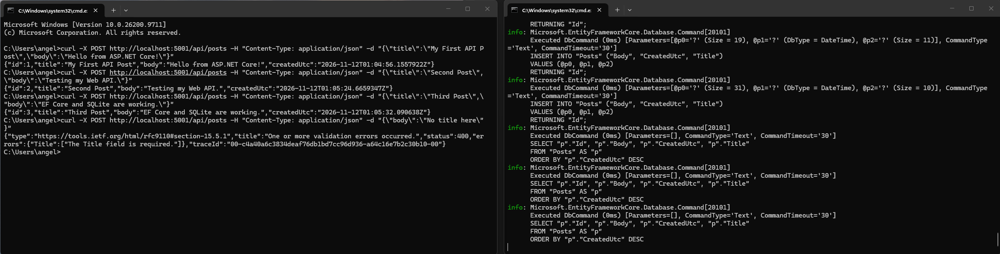
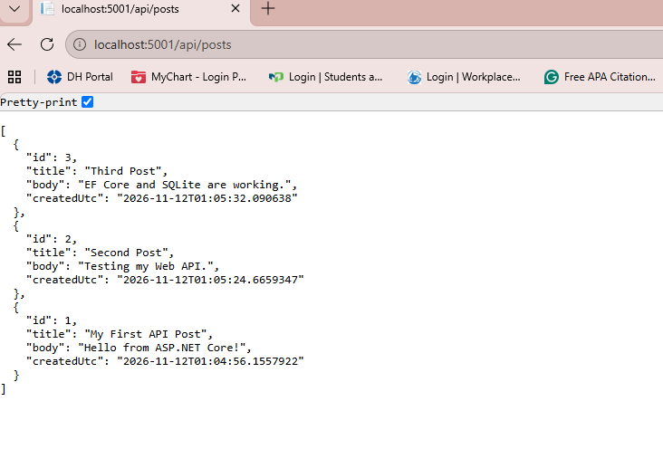
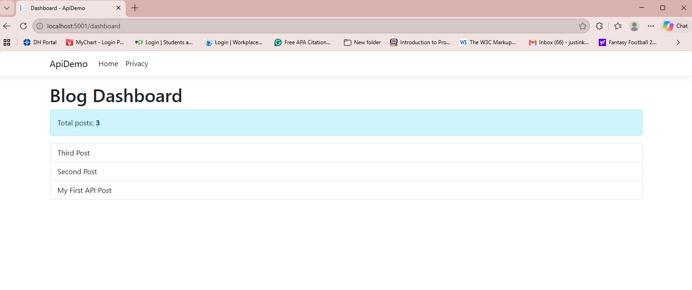

# ApiDemo

An ASP.NET Core Razor Pages app with a Web API for blog posts, using Entity Framework Core and SQLite.

## Features
- `GET /api/posts`: returns all posts as JSON, newest first
- `GET /api/posts/{id}`: returns a single post, or 404 if not found
- `POST /api/posts`: adds a new post with model validation (returns 400 if invalid)
- `/Dashboard`: Razor Page that calls the API with JavaScript and shows the post count and 5 most recent titles

## Technologies
- ASP.NET Core (.NET 9)
- Entity Framework Core 9 with SQLite
- JavaScript `fetch` API

## How to Run
1. Clone the repository
2. Apply the database migration:
   ```
   dotnet ef database update
   ```
3. Run the app:
   ```
   dotnet run
   ```
4. Open `http://localhost:5001/Dashboard`

## Testing with curl
Add a post:
```
curl -X POST http://localhost:5001/api/posts -H "Content-Type: application/json" -d "{\"title\":\"My First API Post\",\"body\":\"Hello from ASP.NET Core!\"}"
```

Get all posts:
```
curl http://localhost:5001/api/posts
```

## Screenshots
### curl requests (POST + validation error)


### GET /api/posts


### Dashboard
